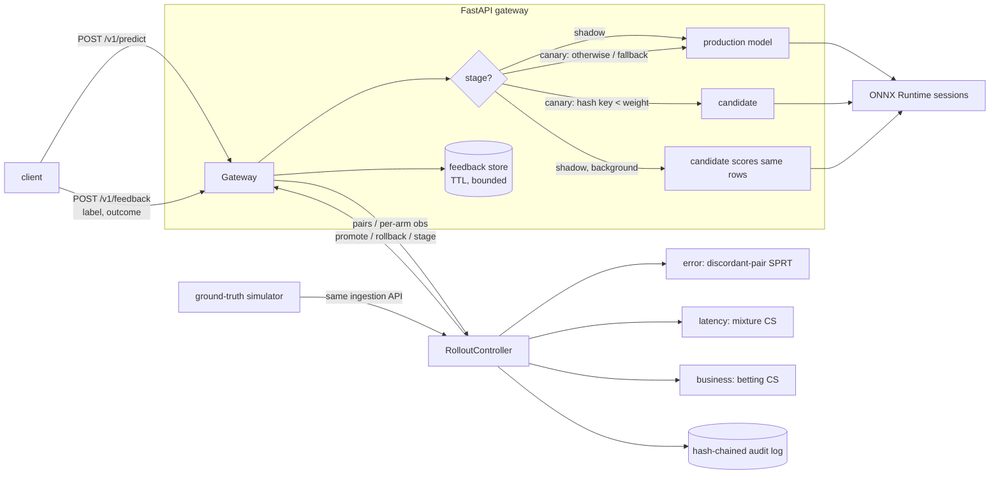

# modelcanary

Progressive delivery for ML models: a FastAPI gateway that serves ONNX models, runs a new
model version in **shadow** and then as a growing **canary**, watches error rate, latency and a
business metric with **sequential statistical tests** (Wald SPRT and always-valid confidence
sequences), and **promotes or rolls back automatically** behind hard guardrails, writing every
decision to a tamper-evident audit trail.

The point of the project is the decision layer. "Ship it if the dashboard looks fine after a
while" is a fixed-sample test evaluated many times; it rolls back good models and promotes bad
ones far more often than its nominal error rate. modelcanary replaces it with procedures whose
error guarantees hold no matter how often you look, and it measures that claim against a
ground-truth simulator over thousands of held-out seeds.

**Who it is for:** ML platform / MLOps engineers who deploy model versions behind an API and
want rollouts whose false-promotion and false-rollback rates are explicit, budgeted and
auditable, and anyone who wants a working, tested reference implementation of SPRT and
confidence-sequence monitoring.

## What it does

- **Serving**: ONNX Runtime sessions (CPU) for any single-input classifier, e.g. scikit-learn
  models exported with `skl2onnx`; `/v1/predict`, `/v1/feedback`, rollout control, audit and
  Prometheus endpoints.
- **Traffic**: shadow stage (production answers, the candidate scores the same rows in a
  background task) followed by canary stages (sticky salted-hash split by routing key,
  e.g. 10% then 50%). Candidate inference failures fall back to production.
- **Online metrics**: error rate from delayed labels, per-call model latency, and a business
  outcome reported with the feedback (e.g. conversion).
- **Sequential tests** (one monitor per metric, budgets split across metrics):
  - error rate: discordant-pair SPRT (sequential McNemar on the error odds ratio) plus an
    always-valid discordance bound for near-identical models;
  - latency: asymptotic normal-mixture confidence sequence (plug-in variance);
  - business metric: hedged-capital betting confidence sequence (finite-sample valid for
    bounded data).
- **Decisions**: failure-rate guardrail → statistical rollback → promotion (all metrics
  non-inferior, minimum stage, minimum live exposure) → stage advance → budget exhaustion.
- **Audit**: SHA-256 hash-chained JSONL; `modelcanary audit <file>` detects edits, deletions
  and reordering.
- **Evaluation**: a simulator with ground-truth better / equal / worse candidates drives the
  real controller; the sequential strategy is compared with a pilot-planned fixed-horizon test
  and with naive peeking over held-out seeds.

## Architecture



Layering (each layer only imports the ones above it in this list):
`stats` → `engine` (+ `audit`) → `sim` / `evaluation` → `serving` → `demo` / `cli`.
Details, formulas and complexity: [docs/ARCHITECTURE.md](docs/ARCHITECTURE.md).

## Quickstart

Requires [uv](https://docs.astral.sh/uv/) and Python 3.12 (uv installs it if missing).

```bash
make check      # ruff format --check + ruff lint + mypy --strict + pytest with coverage gate
make demo       # offline: train 5 sklearn models, export to ONNX, run 4 rollouts over HTTP
make oc         # exact vs Wald operating characteristics of the error-rate SPRT
make eval       # held-out evaluation, writes results/eval.md and results/eval.json
```

Serve your own models (every `*.onnx` in the directory is registered under its file stem):

```bash
uv run modelcanary serve --models var/demo/models --production lr-v1 --audit var/audit.jsonl
curl -s localhost:8000/v1/rollouts -H 'content-type: application/json' \
     -d '{"candidate": "svc-v2"}'
curl -s localhost:8000/v1/predict -H 'content-type: application/json' \
     -d '{"instances": [[0,0,5,13,9,1,0,0,0,0,13,15,10,15,5,0,0,3,15,2,0,11,8,0,0,4,12,0,0,8,8,0,0,5,8,0,0,9,8,0,0,4,11,0,1,12,7,0,0,2,14,5,10,12,0,0,0,0,6,13,10,0,0,0]], "routing_keys": ["user-42"]}'
curl -s localhost:8000/v1/feedback -H 'content-type: application/json' \
     -d '{"items": [{"prediction_id": "<id from predict>", "label": 0, "outcome": 1}]}'
curl -s localhost:8000/v1/rollouts/current     # stage, verdicts, intervals, decision
curl -s localhost:8000/metrics                  # Prometheus text format
uv run modelcanary audit var/audit.jsonl        # verify the hash chain
```

(`make demo` writes the ONNX files to `var/demo/models`.) Policies are TOML or JSON; see
[configs/default.toml](configs/default.toml) (simulator / evaluation) and
[configs/demo.toml](configs/demo.toml) (real models). Environment variables are listed in
[.env.example](.env.example).

## Demo output

`make demo` (real run, pasted verbatim apart from the uv preamble; 5 models trained on half of
the UCI digits data, the other half replayed as traffic; the conversion outcome is simulated —
see [DATA.md](DATA.md)):

```
2026-10-25 17:20:32,595 level=WARNING logger=modelcanary.gateway candidate_inference_failed rollout=demo-4-svc-v5-32px error=model 'svc-v5-32px' failed: [ONNXRuntimeError] : 2 : INVALID_ARGUMENT : Got invalid dimensions for input: X for the following indices (further failures at debug level)
modelcanary demo: progressive delivery of real scikit-learn -> ONNX models
==============================================================================
data: UCI digits via scikit-learn, 898 training rows, 899 held-out rows replayed as traffic (with replacement)
models (true error rate on the traffic pool):
  lr-v1         0.036  logistic regression (current production)
  svc-v2        0.014  RBF support-vector classifier
  knn-v3        0.016  3-nearest-neighbours: accurate but slow
  tree-v4       0.378  depth-5 decision tree: fast but inaccurate
  svc-v5-32px       -  SVC exported for the top half of the image (schema mismatch)

[1] rollout svc-v2 vs production lr-v1: more accurate, slightly slower
        25 requests  stage=shadow     candidate weight=0.00
     1,000 requests  stage=canary-10  candidate weight=0.10
     3,000 requests  stage=canary-50  candidate weight=0.50
  => PROMOTE (all metrics non-inferior) at stage 'canary-50' after 4,825 requests; candidate served 1,089, shadow-scored 1,000
     metric        pairs  baseline   candidate  degradation  interval              verdict
     error_rate      886    0.0361     0.0113      -0.0248  (SPRT llr -4.91)      not_worse
     latency_ms    2,089    0.0388     0.1898       0.1509  [0.1540, 0.1596]      not_worse
     conversion    1,089    0.2957     0.3260      -0.0303  [-0.1160, 0.0480]     not_worse

[2] rollout knn-v3 vs production svc-v2: as accurate, much slower inference
        25 requests  stage=shadow     candidate weight=0.00
  => ROLLBACK (metric worse than baseline: latency_ms) at stage 'shadow' after 200 requests; candidate served 0, shadow-scored 200
     metric        pairs  baseline   candidate  degradation  interval              verdict
     error_rate      200    0.0200     0.0200      -0.0000  (SPRT llr -0.08)      continue
     latency_ms      200    0.1496     1.0482       0.8986  [0.8615, 0.9357]      worse
     conversion        0         -          -            -  [-1.0000, 1.0000]     continue

[3] rollout tree-v4 vs production svc-v2: fast, much less accurate
        25 requests  stage=shadow     candidate weight=0.00
  => ROLLBACK (metric worse than baseline: error_rate) at stage 'shadow' after 50 requests; candidate served 0, shadow-scored 50
     metric        pairs  baseline   candidate  degradation  interval              verdict
     error_rate       48    0.0417     0.5208       0.4792  (SPRT llr 4.19)       worse
     latency_ms       50    0.1391     0.0244      -0.1147  [-0.1681, -0.0612]    continue
     conversion        0         -          -            -  [-1.0000, 1.0000]     continue

[4] rollout svc-v5-32px vs production svc-v2: cannot score 64-feature requests
        25 requests  stage=shadow     candidate weight=0.00
  => ROLLBACK (guardrail: candidate failure rate 1.000 > 0.020) at stage 'shadow' after 50 requests; candidate served 0, shadow-scored 0
     metric        pairs  baseline   candidate  degradation  interval              verdict
     error_rate        0         -          -            -  (SPRT llr 0.00)       continue
     latency_ms        0         -          -            -  (no data)             continue
     conversion        0         -          -            -  [-1.0000, 1.0000]     continue

production model now: svc-v2
audit trail: 15 hash-chained records in audit.jsonl; verified ok=True
tamper check: flipping one rollback to 'promote' -> ok=False, first bad record seq=9 (hash mismatch (record modified))
prometheus /metrics excerpt:
  modelcanary_inference_failures_total{model="svc-v5-32px"} 50
  modelcanary_rollout_decisions_total{action="promote"} 1
  modelcanary_rollout_decisions_total{action="rollback"} 3

wrote var/demo/summary.json and audit.jsonl; demo took 13.1 s
```

Wall-clock latencies vary with machine load; the latency policy margins (rollback once
confidently > 0.5 ms slower, non-inferior if < 1 ms slower) are set so the verdicts above do
not depend on it. The interval column is the *running intersection* of the confidence
sequence; because wall-clock latency drifts with load during the run, the latest point
estimate can sit just outside it (rollout 1) — an instance of the stationarity assumption
listed under Limitations. The single WARNING line is the first inference failure of the
schema-mismatched model; later failures are logged at debug level.

## Evaluation: sequential vs fixed-horizon vs peeking

Command (committed output in [results/eval.md](results/eval.md) and
[results/eval.json](results/eval.json)):

```bash
make eval   # = modelcanary evaluate --seeds 1000 --pilot-seeds 20 --workers 3 --out results
```

Setup: seven ground-truth scenarios against a baseline with 10% error, lognormal latency
(median 40 ms) and 12% conversion — `better` (all three metrics better), `better-error-only`,
`equal`, `worse-error` (10% → 13%, odds ratio 1.34), `worse-latency` (+4.8 ms mean vs a 3 ms
tolerance), `worse-conversion` (12% → 9.5% vs a 2-point tolerance) and `broken` (5% of
candidate calls raise). Each run drives the real `RolloutController` through
shadow → 5% → 25% → 50% with [configs/default.toml](configs/default.toml)
(false-rollback and false-promotion budgets 0.05 each, split over three metrics).
The fixed-horizon test's planning sd comes from an A/A pilot on seeds 0-19; evaluation
seeds start at 1,000,000. All data here is simulated.

**Run:** 1000 held-out seeds x 7 scenarios x 3 strategies (21000 simulated rollouts)

Pilot (A/A, tuning seeds 0..19) planning sd: `error_rate` = 0.4255, `latency_ms` = 44.5916, `conversion` = 0.4603

Evaluation seeds start at 1000000; wall time 325.9 s.

### Error rates by strategy

| strategy | false-promotion rate [95% CI] | false-rollback rate [95% CI] | inconclusive | mean requests (good) | mean requests (worse) | mean candidate exposure (worse) |
|---|---|---|---|---|---|---|
| sequential | 0.001 [0.000, 0.002] | 0.011 [0.008, 0.016] | 0.000 | 39,396 | 7,562 | 2,125 |
| fixed_horizon | 0.000 [0.000, 0.001] | 0.020 [0.016, 0.026] | 0.000 | 29,088 | 16,344 | 4,543 |
| peeking | 0.006 [0.004, 0.009] | 0.170 [0.157, 0.184] | 0.000 | 10,829 | 2,830 | 294 |

### Per scenario

| scenario | truth | strategy | runs | P(promote) | mean req | median req | p90 req | mean candidate req |
|---|---|---|---|---|---|---|---|---|
| better | better | fixed_horizon | 1000 | 1.000 | 29,152 | 29,000 | 29,500 | 9,778 |
| better | better | peeking | 1000 | 0.977 | 10,054 | 9,000 | 14,500 | 1,274 |
| better | better | sequential | 1000 | 0.998 | 23,146 | 21,000 | 37,000 | 6,928 |
| better-error-only | better | fixed_horizon | 1000 | 0.975 | 29,090 | 29,000 | 29,500 | 9,747 |
| better-error-only | better | peeking | 1000 | 0.796 | 11,432 | 10,500 | 18,000 | 1,868 |
| better-error-only | better | sequential | 1000 | 0.996 | 47,804 | 42,000 | 84,050 | 19,155 |
| broken | worse | fixed_horizon | 1000 | 0.000 | 501 | 500 | 500 | 0 |
| broken | worse | peeking | 1000 | 0.000 | 501 | 500 | 500 | 0 |
| broken | worse | sequential | 1000 | 0.000 | 501 | 500 | 500 | 0 |
| equal | equal | fixed_horizon | 1000 | 0.965 | 29,022 | 29,000 | 29,500 | 9,713 |
| equal | equal | peeking | 1000 | 0.718 | 11,000 | 10,500 | 17,500 | 1,787 |
| equal | equal | sequential | 1000 | 0.972 | 47,237 | 40,750 | 83,000 | 18,865 |
| worse-conversion | worse | fixed_horizon | 1000 | 0.001 | 29,022 | 29,000 | 29,500 | 9,713 |
| worse-conversion | worse | peeking | 1000 | 0.023 | 9,160 | 8,500 | 15,000 | 1,162 |
| worse-conversion | worse | sequential | 1000 | 0.002 | 25,969 | 24,000 | 42,500 | 8,351 |
| worse-error | worse | fixed_horizon | 1000 | 0.000 | 22,383 | 22,500 | 22,500 | 6,392 |
| worse-error | worse | peeking | 1000 | 0.000 | 1,074 | 1,000 | 1,500 | 15 |
| worse-error | worse | sequential | 1000 | 0.000 | 2,814 | 2,000 | 7,000 | 144 |
| worse-latency | worse | fixed_horizon | 1000 | 0.000 | 13,468 | 13,500 | 13,500 | 2,067 |
| worse-latency | worse | peeking | 1000 | 0.000 | 586 | 500 | 1,000 | 0 |
| worse-latency | worse | sequential | 1000 | 0.000 | 966 | 1,000 | 1,500 | 4 |

What the numbers say (all from the table above):

- **Both valid procedures stay inside their budgets** (0.05 each). Sequential: false promotion
  0.001, false rollback 0.011. Fixed horizon: 0.000 and 0.020.
- **Peeking is not valid**: re-running the fixed-sample z-tests at every check rolls back
  17.0% of good candidates (28% of `equal` ones) — 3.4x the nominal budget.
- **Sequential stops bad candidates early**: 7,562 requests on average for worse candidates vs
  16,344 for the fixed horizon, with less than half the users exposed to the bad model
  (2,125 vs 4,543 candidate-served requests). `worse-error` and `worse-latency` are mostly
  caught during shadow (144 and 4 candidate-served requests on average).
- **The price is paid on good candidates**: proving non-inferiority anytime-validly takes
  longer than a single planned test — 39,396 vs 29,088 requests on average, with a long tail
  (p90 = 83,000 requests for `equal`). The fixed-horizon test, however, needs a variance guess in
  advance and cannot stop early when a candidate is clearly broken or clearly worse.

## Statistical procedures checked against analytic results

`make oc` (exact lattice dynamic programme vs Wald's approximations for the policy's
error-rate SPRT; `alpha` = per-metric rollback budget 0.05/3, `beta` = half the per-metric
promotion budget):

Error-rate SPRT on discordant pairs: H0 p=0.5 vs H1 p=0.5556, alpha=0.0167, beta=0.0083

| odds ratio | P(cand wrong / discordant) | P(rollback) exact | P(rollback) Wald | E[discordant pairs] exact | E[discordant pairs] Wald |
|---|---|---|---|---|---|
| 0.70 | 0.4118 | 0.0000 | 0.0000 | 186 | 184 |
| 0.85 | 0.4595 | 0.0000 | 0.0000 | 316 | 313 |
| 1.00 | 0.5000 | 0.0159 | 0.0167 | 754 | 744 |
| 1.10 | 0.5238 | 0.3802 | 0.3821 | 1,578 | 1,544 |
| 1.25 | 0.5556 | 0.9921 | 0.9917 | 657 | 649 |
| 1.50 | 0.6000 | 1.0000 | 1.0000 | 257 | 254 |
| 2.00 | 0.6667 | 1.0000 | 1.0000 | 134 | 132 |

The exact rollback probability at OR = 1 (0.0159) is below the nominal 0.0167 and the
exact ASN is slightly above Wald's (overshoot), as theory predicts.

The test-suite (`tests/test_sprt.py`, `tests/test_confseq.py`, `tests/test_fixed.py`) checks,
among others:

| Procedure | Analytic check |
|---|---|
| Wald SPRT | `h(p0)=1`, `h(p1)=−1`; `L(p0)=1−α`, `L(p1)=β`; zero-drift ASN formula and continuity; exact DP satisfies `α' ≤ α/(1−β)`, `β' ≤ β/(1−α)`, `α'+β' ≤ α+β`; online test matches the DP's OC and ASN by Monte-Carlo (4,000 runs, 4σ) |
| Discordant pairs | `P(c wrong \| discordant) = OR/(1+OR)` identity, checked by simulation on 400k pairs |
| Normal mixture | closed-form mixture martingale = numerical quadrature (rel 1e-7); `M_t = 1/α` exactly on the boundary; optimal ρ minimises the radius at t*; LIL-rate shrinkage |
| Confidence sequences | time-uniform coverage ≥ 1−α (known-σ mixture: 2,000 Gaussian paths × 2,000 steps; asymptotic CS on lognormal data; betting CS on Bernoulli 0.05/0.5/0.9), and a repeatedly-checked fixed-n CI fails the same test |
| Betting CS | `E[(K⁺+K⁻)/2] = 1` at the true mean (martingale property) by Monte-Carlo |
| Fixed horizon | power-analysis sample size formula; the planned n achieves the nominal power and size by Monte-Carlo; 40 peeks inflate the 5% type-I error more than 3x |
| Wilson interval | reference values for 0/10 and 5/10 |

## Tests and coverage

`make check` from a fresh clone (format check, lint with zero warnings, `mypy --strict` over
`src` and `tests`, pytest with an 85% branch-coverage gate):

```
144 passed in 51.26s
TOTAL                                     2435     19    460     24    99%
Required test coverage of 85.0% reached. Total coverage: 98.51%
```

Unit tests cover each statistical procedure, monitor, policy validation, pairing, the
controller state machine, the audit chain (edit / delete / swap / re-hash attacks), the
simulator and the harness; integration tests run the gateway with real ONNX models in-process
(shadow, canary split stickiness, fallback, stale feedback, HTTP error mapping, Prometheus
output) and the full demo through the CLI. Size: `find src -name '*.py' | xargs wc -l` →
4455 lines of source, `find tests -name '*.py' | xargs wc -l` → 1913 lines of tests.

## Design decisions

The full log with costs is in [DECISIONS.md](DECISIONS.md). The ones that matter most:

- **Paired one-sample tests.** Shadow requests give natural pairs; canary arms are paired FIFO.
  Every monitor then sees one i.i.d. stream whose mean is the true degradation.
- **Error rate via discordant pairs.** Under "no difference" `P(candidate is the wrong one |
  exactly one is wrong) = 0.5` for independent *and* for correlated (shadow) pairs, so the SPRT's
  false-rollback guarantee does not depend on how similar the two models are.
- **Two thresholds per metric.** `tolerance` (non-inferiority margin, gates promotion) and
  `rollback_margin` (how much confident degradation triggers rollback, default 0).
- **Budgets are explicit.** `false_rollback_budget` and `false_promotion_budget` are split
  across metrics by Bonferroni; the error-rate monitor further splits its promotion share
  between the SPRT and the discordance bound.
- **Guardrails act before statistics.** A candidate that throws on > 2% of calls is rolled back
  without waiting for any test; promotion additionally requires live exposure.
- **Planning the baseline honestly.** The fixed-horizon test's variance comes from an A/A pilot
  on reserved tuning seeds; evaluation seeds are disjoint and the code refuses overlap.

## Limitations

- **Simulated evaluation.** The false-promotion / false-rollback numbers come from a simulator
  with i.i.d. Bernoulli / lognormal traffic, immediate labels and stationary behaviour. Real
  traffic has diurnal cycles, delayed and missing labels, and novelty effects; none of that is
  evaluated here.
- **Asymptotic latency CS.** The latency monitor is only asymptotically valid (plug-in variance);
  heavy tails make early intervals optimistic. `min_pairs` mitigates but does not remove this.
- **Mixed shadow and canary pairs.** A monitor pools shadow pairs (correlated) and canary pairs
  (independent). The SPRT's type-I guarantee holds for both; the betting/mixture CSs assume one
  stationary mean, which holds for the degradation mean but not for its variance.
- **Bonferroni is conservative**; decisions take longer than a dependence-aware split would.
  In the evaluation the sequential strategy needs *more* traffic than the fixed-horizon test
  to promote good candidates (see the table) — the price of being allowed to stop early.
- **Single process, in-memory state.** One gateway process owns the rollout; there is no
  shared state store, leader election or restart recovery of a running rollout (the audit log
  survives and is verified on restart, the controller state does not).
- **Latency is wall-clock inside `InferenceSession.run`** on the serving host, measured per
  call; batched requests mix batch sizes into the metric.
- **Audit chain is tamper-evident, not tamper-proof**: whoever can rewrite the entire file can
  recompute every hash. Anchor the head hash externally for stronger guarantees.
- **Demo business metric is simulated** (conversion probability depends on correctness), and the
  demo replays a 899-row pool with replacement, so it shows the mechanics, not production
  performance. CI has not run yet (the workflow is committed but the repository has not been
  pushed).

## Roadmap

- Persist controller state (snapshot + audit replay) so a restarted gateway resumes a rollout.
- Delayed-feedback-aware monitors (label delay as part of the simulator and the evaluation).
- Dependence-aware budget splitting (e.g. closed testing / e-value merging across metrics).
- Variance-adaptive empirical-Bernstein CS for latency with finite-sample validity under a
  known upper bound (timeouts make latency bounded in practice).
- Kubernetes/Envoy integration: export the routing decision as a header for an external proxy
  instead of calling models in-process.

## Repository map

```
src/modelcanary/stats/       SPRT, confidence sequences, fixed-horizon tests, running moments
src/modelcanary/engine/      policy, monitors, pairing, RolloutController
src/modelcanary/audit.py     hash-chained audit log
src/modelcanary/sim/         ground-truth scenarios and traffic simulator
src/modelcanary/evaluation/  harness, pilot tuning, OC tables, report
src/modelcanary/serving/     ONNX registry, router, feedback join, Gateway, FastAPI app
src/modelcanary/demo/        scikit-learn -> ONNX demo
configs/                     default.toml (simulation), demo.toml (real models)
results/                     committed evaluation output (eval.md, eval.json)
docs/ARCHITECTURE.md         design, algorithms, complexity
```

## References

- A. Wald, *Sequential tests of statistical hypotheses*, Ann. Math. Statist. 16 (1945).
- H. Robbins, *Statistical methods related to the law of the iterated logarithm*, Ann. Math. Statist. 41 (1970).
- I. Waudby-Smith, D. Arnold, Z. S. Wu, Y.-X. Wang, A. Ramdas, *Time-uniform central limit
  theory and asymptotic confidence sequences*, arXiv:2103.06476 (2021).
- I. Waudby-Smith, A. Ramdas, *Estimating means of bounded random variables by betting*,
  JRSS-B 86(1) (2024).
- S. R. Howard, A. Ramdas, J. McAuliffe, J. Sekhon, *Time-uniform, nonparametric,
  nonasymptotic confidence sequences*, Ann. Statist. 49(2) (2021).

## License

MIT — see [LICENSE](LICENSE).
