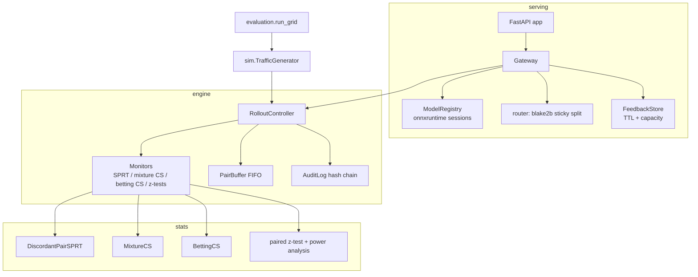

# Architecture

modelcanary is a library plus a thin HTTP service. Each layer depends only on the layers
below it, so the statistical core can be tested without serving and the serving layer can
be simulated without HTTP.

```
modelcanary/
  stats/        pure statistics: SPRT, confidence sequences, fixed-horizon z-tests, running moments
  engine/       policy (pydantic), monitors (metric -> verdict), FIFO pairing, RolloutController
  audit.py      hash-chained JSONL audit log
  sim/          ground-truth scenarios + vectorised traffic generator driving a real controller
  evaluation/   many-seed harness, pilot tuning, OC tables, report rendering
  serving/      ONNX Runtime registry, sticky router, feedback join, Gateway core, FastAPI app
  demo/         scikit-learn -> ONNX models + scripted rollouts through the HTTP API
  cli.py        argparse front end for all of the above
```



## Request lifecycle

1. `POST /v1/predict` validates rows (`to_features`: rectangular, finite, `float32`).
2. With no running rollout the production model answers and nothing is remembered.
3. **Shadow stage**: production answers; a `PendingPrediction` per row is stored in the
   `FeedbackStore`; a `ShadowJob` is queued as a FastAPI background task. The job runs the
   candidate on the same rows, fills `candidate_label` into the pending records, records one
   paired latency observation `(t_baseline, t_candidate)` and the attempt/failure counts.
4. **Canary stage**: each row's arm is `bucket(rollout_id, routing_key) < weight`. Candidate
   rows are scored in one ONNX call; if it raises, those rows are re-scored by production and
   counted as failures. Each successful call contributes one latency observation to its arm.
5. `POST /v1/feedback` pops the pending record. Shadow: if the candidate label exists, the two
   error indicators form a pair. Canary: the error indicator (and the business outcome, if
   given) is recorded for the arm that served it and paired FIFO inside the controller.
   Feedback for an earlier rollout is counted as `stale`; unknown/expired ids as `unmatched`.
6. After every predict, shadow job and feedback batch, `Gateway._maybe_decide` calls
   `controller.maybe_evaluate()`; a promotion swaps the production pointer under the gateway lock.

## Controller decision procedure

`RolloutController.evaluate()` runs at most once per `check_every` events. First match wins:

| # | Condition | Action |
|---|---|---|
| 1 | `candidate_failures / candidate_attempts > max_candidate_failure_rate` after `min_failure_attempts` | rollback (guardrail) |
| 2 | any monitor verdict is `WORSE` | rollback |
| 3 | all monitors `NOT_WORSE` and stage ≥ `promote_min_stage` and request + candidate-request minimums met | promote |
| 4 | current stage served `min_requests` and a next stage exists | advance stage (audit `stage_advanced`) |
| 5 | `requests ≥ max_requests` | `on_inconclusive` (rollback by default), flagged inconclusive |

States: `running → promoted | rolled_back | aborted`; terminal states ignore further input.
Every verdict change, stage change and terminal decision is appended to the audit log with
the full monitor snapshots (pairs, arm means, degradation, interval, statistic).

## Key algorithms

### Discordant-pair SPRT (error rate)

For pairs of error indicators `(b_i, c_i)` only discordant pairs (`b_i ≠ c_i`) are informative.
With error odds ratio `OR = [p_c/(1-p_c)] / [p_b/(1-p_b)]` and independent arms,
`P(c_i = 1 | discordant) = OR / (1 + OR)`. The monitor runs Wald's SPRT on these Bernoulli
outcomes with `H0: p = 0.5` (OR = 1) against `H1: p = OR₁/(1+OR₁)`:

```
llr_n = k log(p1/p0) + (n - k) log((1-p1)/(1-p0))
accept H1 (rollback) when llr_n ≥ log((1-β)/α);  accept H0 when llr_n ≤ log(β/(1-α))
```

Validated against (a) Wald's identities `L(p0) = 1-α`, `L(p1) = β`, `h(p0)=1`, `h(p1)=-1`,
(b) the **exact** operating characteristic computed by dynamic programming over the lattice
of `(n, k)` (`exact_operating_characteristics`, O(N²) time, O(N) memory), including the exact
inequalities `α' ≤ α/(1-β)`, `β' ≤ β/(1-α)`, `α'+β' ≤ α+β`, and (c) Monte-Carlo runs of the
online implementation against the DP. Update cost: O(1) per pair (vectorised per batch).

**Discordance shortcut.** `p_c - p_b = P(c=1,b=0) - P(c=0,b=1) ≤ P(discordant)`. A betting
CS on the discordance indicator whose upper bound drops below `tolerance` proves
non-inferiority even when the SPRT has seen no discordant pairs. β and the shortcut's α each
get half of the metric's promotion budget.

### Normal-mixture confidence sequence (latency)

Mixing the exponential supermartingale `exp(λS_t − λ²σ²t/2)` over `λ ~ N(0, ρ²)` gives
`M_t = (1+tρ²)^{-1/2} exp(ρ²S_t²/(2σ²(1+tρ²)))`. Ville's inequality `P(∃t: M_t ≥ 1/α) ≤ α`
yields the radius

```
r_t = σ sqrt( 2 (tρ² + 1) / (t² ρ²) · log( sqrt(tρ² + 1) / α ) )
```

`ρ` is chosen to minimise `r_{t*}` at a planning horizon `t*` (validity holds for any `ρ`).
With σ replaced by the running sample sd this is the asymptotic CS of Waudby-Smith, Arnold,
Wu, Wang & Ramdas (2021). Tests check the closed form of `M_t` against numerical quadrature,
that `M_t = 1/α` exactly on the boundary, the LIL-rate shrinkage, time-uniform coverage on
Gaussian data (and that a naive repeated fixed-n CI fails it), and coverage on lognormal data.
Cost: O(1) per observation.

### Hedged-capital betting confidence sequence (conversion, discordance)

For data in `[0,1]` and each candidate mean `m` on a grid, two capital processes
`K⁺_t(m) = Π(1 + λ⁺_i(m)(x_i − m))`, `K⁻_t(m) = Π(1 − λ⁻_i(m)(x_i − m))` use predictable
bets `λ_i = sqrt(2 log(2/α) / (σ̂²_{i−1} i log(1+i)))` truncated at `c/m` and `c/(1−m)`.
`(K⁺ + K⁻)/2` is a non-negative martingale under `μ = m`, so `{m : (K⁺+K⁻)/2 < 1/α}` is a
`(1−α)` CS (Waudby-Smith & Ramdas, JRSS-B 2024). Differences of two Bernoulli outcomes are
mapped from `[-1, 1]`. Tests check coverage on Bernoulli streams, the martingale property
`E[(K⁺+K⁻)/2] = 1` at the true mean by Monte-Carlo, shrinkage and degenerate inputs.
Cost: O(G) time per observation and O(G) memory for a grid of G points (500-1000 here).

### Intersection with restart

Every CS keeps the running intersection `∩_s C_s` (still a valid CS, never wider). If a new
interval is disjoint from it (probability ≤ α under stationarity), the intersection restarts
from the new interval and `resets` increments, so a regression that starts mid-rollout is
still detected.

### Fixed-horizon and peeking comparators

`n* = ⌈((z_{1−α_p} + z_{1−α_r}) σ / tolerance)²⌉` pairs (power `1 − α_r` to show
non-inferiority at zero true degradation); at `n*` a single one-sided z-test decides
non-inferior (promote side) or not (rollback). Peeking runs the same pair of one-sided
z-tests at every check — included to measure the inflation that sequential methods avoid.

### Sticky routing

`bucket = uint64(blake2b_8(salt ∥ 0x00 ∥ key)) / 2^64`; candidate iff `bucket < weight`.
Monotone in `weight` (users never flip back when the canary grows) and independent across
rollouts because the salt is the rollout id. O(1) per request.

### Audit hash chain

`hash_i = SHA-256(hash_{i−1} ∥ canonical_json(record_i \ {hash}))` with sorted keys and no
NaN. Verification is O(n); editing, deleting or reordering any record breaks the chain at
that record (or at the next back-link if the attacker re-hashes the edited record).

## Concurrency

FastAPI runs sync endpoints in a thread pool. `RolloutController`, `AuditLog`,
`FeedbackStore`, `ModelRegistry`, `Counters` and `Gateway` each hold their own lock;
lock order is always gateway → controller → audit, so there is no inversion. ONNX Runtime
sessions are safe for concurrent `run` calls. `maybe_evaluate` returns a decision exactly
once (the status changes under the controller lock), so two threads cannot both act on it.

## Complexity summary

| Operation | Time | Memory |
|---|---|---|
| SPRT / mixture CS update | O(1) per pair | O(1) |
| Betting CS update | O(G) per observation | O(G) |
| Pair buffer push | O(batch + backlog) | O(capacity) per metric |
| Controller evaluate | O(metrics) (+ O(G) to snapshot a betting CS) | — |
| Router | O(1) per row | — |
| Feedback store put/pop | amortised O(1) | O(capacity) |
| Audit append / verify | O(1) / O(records) | O(memory_limit) in RAM |
| Exact SPRT OC (analysis only) | O(N²) | O(N) |

## Evaluation methodology

`evaluation.run_evaluation`:

1. **Pilot** (`tuning.pilot_planning_sd`): A/A canary pairs for the baseline profile on seeds
   0..19 (inside the reserved tuning range `[0, 100000)`) give the planning sd per metric for
   the fixed-horizon test.
2. **Grid**: every scenario × {sequential, fixed_horizon, peeking} × held-out seeds starting at
   1,000,000 (`eval_seeds` refuses any overlap with the tuning range). Each run drives a real
   `RolloutController` through all stages with the default policy until it decides.
3. **Scoring** against `derive_truth`: false promotion = promoted when truth is WORSE; false
   rollback = rolled back when truth is BETTER or EQUAL (inconclusive rollbacks included).
   Rates carry Wilson 95% intervals. Mean requests and candidate exposure measure cost.
